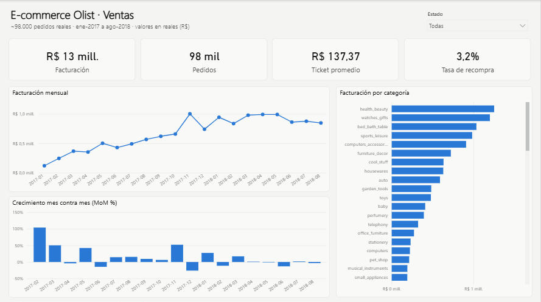
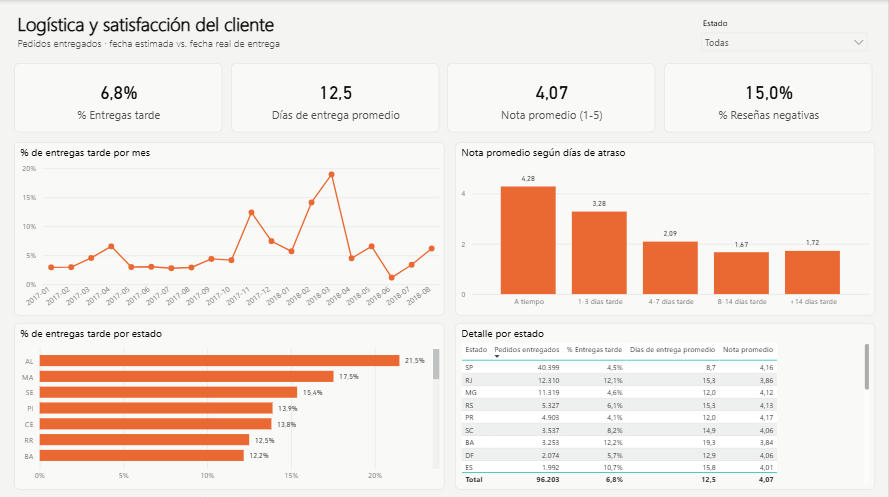
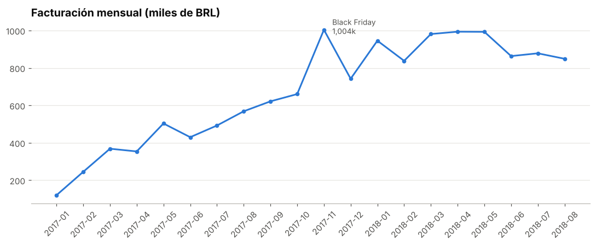
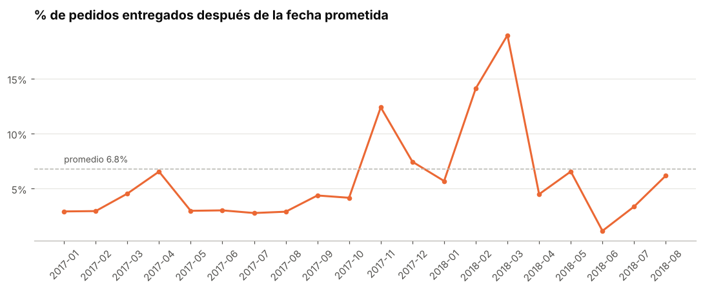
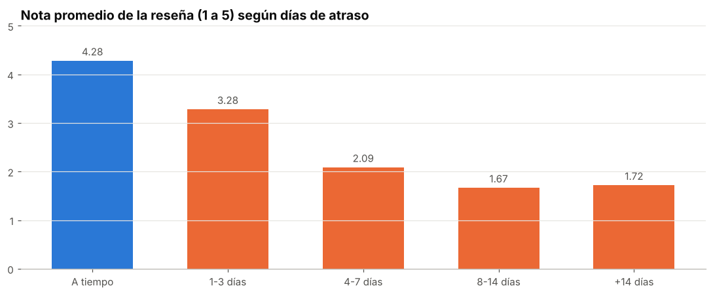
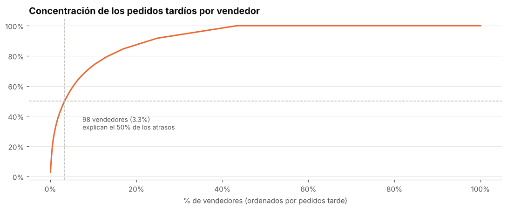

# ¿Cuánto le cuestan las demoras de entrega a un e-commerce?

**Análisis de ventas, logística y satisfacción sobre ~98.000 pedidos reales** del marketplace brasileño Olist (ene-2017 a ago-2018).

`Python (Pandas)` · `SQL (CTEs, funciones de ventana)` · `Power BI (DAX, Power Query)` · `Jupyter`

---

## Resumen ejecutivo

La empresa creció **~50% interanual** en facturación, pero la logística no acompañó en los picos de demanda. Medí cuánto impacta un atraso en la experiencia del cliente y dónde se origina el problema.

| Hallazgo | Dato |
|---|---|
| Un pedido entregado tarde recibe **6,6 veces más reseñas negativas** | 63% vs 9,5% |
| Con solo 1-3 días de atraso, la nota promedio cae **de 4,3 a 3,3** | más de 7 días: debajo de 2 |
| **98 vendedores (3% del total) generan el 50% de los atrasos** | de 2.934 vendedores activos |
| Si el vendedor despacha tarde, el pedido llega tarde **4 veces más seguido** | 21,1% vs 5,4% |
| En picos de demanda el atraso se triplica | Black Friday 2017: 12% · mar-2018: 19% |
| Río de Janeiro, el 2.º mercado, entrega tarde **2,7 veces más que São Paulo** | 12,1% vs 4,5% |

**Impacto estimado:** con solo lograr que los vendedores despachen a tiempo se evitarían **~1.350 pedidos tardíos (21% del total)** y ~720 reseñas negativas en el período.

## Recomendaciones

1. **Tratar la puntualidad como un KPI comercial**, no solo logístico: es el factor que más destruye la satisfacción.
2. **Programa de seguimiento a los ~100 vendedores** que concentran los atrasos (alertas, penalidades o menor visibilidad).
3. **Plan de capacidad logística antes de fechas pico** (Black Friday, inicio de año).
4. **Revisar transportista y fecha prometida** en el Nordeste y Río de Janeiro.

---

## Tablero en Power BI

Dos páginas: **Ventas** (facturación, pedidos, ticket promedio, recompra, crecimiento MoM, categorías) y **Logística y satisfacción** (% de entregas tarde, días de entrega, nota promedio, detalle por estado). Se puede filtrar por estado.





📥 **[Descargar el tablero (.pbix)](powerbi/Olist_Ventas_Logistica.pbix)**: se abre con Power BI Desktop y ya incluye los datos.

**Modelo de datos (esquema estrella):** `orders` (hechos, 1 fila por pedido) ← `order_items` (ítems y categoría) · `Calendario` (tabla de fechas en DAX) · `_Medidas` (tabla de medidas).

<details>
<summary><b>Medidas DAX principales</b></summary>

```dax
Facturación = CALCULATE(SUM(orders[product_value]), orders[valid] = 1)

Facturación mes anterior = CALCULATE([Facturación], DATEADD(Calendario[Fecha], -1, MONTH))

Crecimiento MoM % =
VAR Actual = [Facturación]
VAR Anterior = [Facturación mes anterior]
RETURN IF(NOT ISBLANK(Anterior), DIVIDE(Actual - Anterior, Anterior))

% Entregas tarde = DIVIDE([Pedidos tarde], [Pedidos entregados])

% Reseñas negativas =
DIVIDE(
    CALCULATE(COUNTROWS(orders), orders[review_score] <= 2),
    CALCULATE(COUNTROWS(orders), NOT ISBLANK(orders[review_score]))
)

Tasa de recompra =
DIVIDE(
    CALCULATE(DISTINCTCOUNT(orders[customer_unique_id]), orders[customer_repurchased] = 1, orders[valid] = 1),
    [Clientes]
)
```
</details>

## Análisis

| | |
|---|---|
|  |  |
|  |  |

El análisis completo, con cada gráfico y su lectura, está en [`notebooks/analisis_exploratorio.ipynb`](notebooks/analisis_exploratorio.ipynb).

## SQL

[`sql/analysis.sql`](sql/analysis.sql) tiene 10 consultas que responden las preguntas del negocio. Por ejemplo, la concentración de atrasos por vendedor:

```sql
WITH pedido_vendedor AS (
    SELECT order_id, MIN(seller_id) AS seller_id FROM order_items GROUP BY order_id
),
por_vendedor AS (
    SELECT pv.seller_id, COUNT(*) AS pedidos, SUM(o.is_late) AS pedidos_tarde
    FROM pedido_vendedor pv JOIN orders o ON o.order_id = pv.order_id
    WHERE o.is_delivered = 1
    GROUP BY pv.seller_id
),
ranking AS (
    SELECT *,
           ROW_NUMBER() OVER (ORDER BY pedidos_tarde DESC) AS rk,
           1.0 * SUM(pedidos_tarde) OVER (ORDER BY pedidos_tarde DESC
                 ROWS BETWEEN UNBOUNDED PRECEDING AND CURRENT ROW)
               / SUM(pedidos_tarde) OVER () AS share_acum
    FROM por_vendedor
)
SELECT MIN(CASE WHEN share_acum >= 0.5 THEN rk END) AS vendedores_que_explican_50pct_atrasos
FROM ranking;
```

Resultados de todas las consultas: [`reports/resultados_sql.md`](reports/resultados_sql.md).

## Datos y limpieza

**Fuente:** [Brazilian E-Commerce Public Dataset by Olist](https://www.kaggle.com/datasets/olistbr/brazilian-ecommerce) (Kaggle, licencia CC BY-NC-SA 4.0): 8 tablas relacionales con ~100.000 pedidos reales anonimizados.

Decisiones principales (detalle en [`reports/calidad_de_datos.md`](reports/calidad_de_datos.md)):

- **Cliente único:** `customer_id` cambia en cada compra; para medir recompra uso `customer_unique_id`.
- **Reseñas duplicadas:** 1.114 reseñas pertenecen a pedidos con más de una; conservo la más reciente.
- **Período:** analizo solo meses completos (ene-2017 a ago-2018) para no distorsionar tendencias.
- **Definición de atraso:** entregado un día calendario después de la fecha estimada informada al cliente.
- **Responsabilidad del vendedor:** comparo la fecha de entrega al correo con el límite de despacho pactado.

**Limitaciones:** no hay datos de costo logístico ni de transportista; la relación entre atraso y recompra es una asociación, no una causalidad probada.

## Estructura

```
├── data/powerbi/         CSV que consume el tablero
├── notebooks/            Análisis exploratorio con conclusiones
├── powerbi/              Tablero (.pbix) y proyecto Power BI (.pbip): modelo, medidas DAX y reporte
├── reports/              Calidad de datos, resultados SQL y gráficos
├── sql/analysis.sql      Consultas de negocio
└── src/
    ├── clean.py          Limpieza, validación y armado de tablas analíticas
    ├── run_sql.py        Carga en SQLite y ejecución de las consultas
    └── export_powerbi.py Exportación de los CSV para Power BI
```

## Cómo reproducirlo

```bash
pip install -r requirements.txt
# 1. Descargar el dataset de Kaggle y descomprimirlo en data/raw/
python src/clean.py            # limpieza + reporte de calidad
python src/run_sql.py          # consultas SQL
python src/export_powerbi.py   # CSV para Power BI
jupyter notebook notebooks/analisis_exploratorio.ipynb
```

**Power BI:** `powerbi/Olist_Ventas_Logistica.pbix` se abre directo con los datos incluidos. Para editar el proyecto en formato texto (control de versiones), abrir `powerbi/Olist_Ventas_Logistica.pbip` con Power BI Desktop. Si la carpeta del proyecto está en otra ruta, actualizar el parámetro `CarpetaDatos` (Transformar datos → Administrar parámetros) para que apunte a `data/powerbi/` y luego **Actualizar**.

---

**Gastón Szylak** · Analista de Datos · [LinkedIn](https://www.linkedin.com/in/gastonszylak) · [GitHub](https://github.com/gastonszylak)
